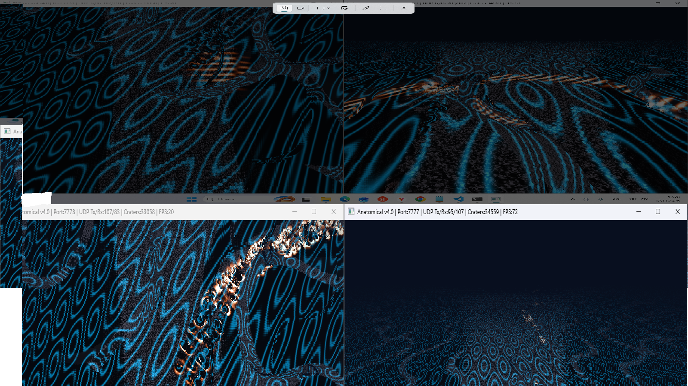

# Anatomical Engine: Continuous Analytical Reality with Tensor SDF & Escher Matrices



> **A novel computational paradigm replacing traditional polygon/voxel asset streaming and heavy network replication with a continuous, deterministic mathematical continuum.**

---

## Overview & Paradigm Shift

Modern large-scale space simulators and open-world engines (such as *StarEngine* or *Unreal Engine 5*) suffer from **informational materialism**—a bottleneck where scaling up virtual worlds requires a proportional explosion in storage footprints (I/O limits) and network bandwidth.

**Anatomical Reality (AR)** shifts the architecture toward **Informational Potentialism**. Geometry, material density, gravity, and electromagnetic fields exist strictly as an uncollapsed mathematical potential. Space materializes into empirical surface data exclusively along the trajectory vectors of interaction (the observer's "looks") via GPU-accelerated Spherical Ray Marching.

### Core Architectural Milestones

1. **Planetary Scale Invariance (Nested Local Singularities):** Encodes a 30,000 km super-Earth alongside continuous 100-km subterranean cave networks within a static **1–100 GB footprint** on non-volatile media, eliminating floating-point vertex jitter without `float64` GPU overhead.
2. **Controlled Escher Recursion:** Suppresses chaotic procedural fractals by gating high-frequency micro-details with an exponential distance-attenuation law ($\Gamma(\text{SDF})$). Micro-fissures and pores unwrap exclusively when the camera approaches a surface boundary ($|\text{SDF}| \to 0$).
3. **Embedded Continuum Physics:** Integrates classical partial differential equations directly into the Signed Distance Field fabric:
   - **Poisson Gravity:** Authentic gravitational shielding inside deep 100-km caverns.
   - **Maxwellian Electrodynamics:** Analytical crustal ore magnetism causing real-time Lorentz thrust deflection and eddy-current sensor interference.
   - **Navier-Cauchy Stress Tensors:** Physics-driven rock yielding and structural failure.
4. **Entangled State Network (ESN):** Replaces legacy *Server Meshing* chunk replication with **64-byte Cache-Aligned Perturbation Vector Operators ($\Delta$)**. Clients and servers remain mathematically entangled via identical sparse directed hash-graphs, neutralizing network desync.

---

## Interactive GPU Proof-of-Concept (`src/main.cpp`)

This repository includes a lightweight, zero-bloat C++17 / OpenGL 3.3 real-time sandbox demonstrating the core shader pipeline:
- **Spherical Ray Marching** through an inverted analytical 100-km cavern spline.
- **Real-time Maxwellian magnetic flux visualization** across rock strata.
- **Interactive 64-byte $\Delta$-Operator Cratering:** Left-click anywhere on the cavern walls to dispatch a simulated network perturbation packet and dynamically carve a glowing impact crater into the SDF continuum at 60+ FPS.

### Controls
- **`W` `A` `S` `D`** — Free-flight navigation through the subterranean tunnel.
- **`Left Shift`** — Thruster afterburner (3.5x velocity boost).
- **`Mouse`** — 360-degree camera orientation.
- **`Left Mouse Button (LMB)`** — Dispatch 64-byte Perturbation Vector Operator (carve impact crater).
- **`ESC`** — Exit simulation.

### Quick Build Instructions (Windows / MinGW-w64)
Ensure `GLFW` and `GLAD` headers/libraries are placed in `include/` and `lib/`, then compile via:
```bash
g++ -O3 src/main.cpp glad.c -Iinclude -Llib -lglfw3 -lopengl32 -lgdi32 -o anatomical_sandbox.exe
```

---

## Whitepaper & Intellectual Property

The complete 18-page mathematical formulation—covering Lipschitz-bounded step stabilization, GPU Tensor Core (`FP8`/`FP4`) matrix quantization, and deterministic topological entropy—is available in this repository (`Anatomical_Engine_Whitepaper.pdf`) and archived on **ai.viXra.org** (Submission `#18424024`).

**License & Commercial Inquiries:**  
The architectural concepts, mathematical formulations, and whitepaper are protected under the **Creative Commons Attribution-NonCommercial-NoDerivatives 4.0 International (CC BY-NC-ND 4.0)** license.  

For commercial licensing, R&D consulting, or core engine integration inquiries, please contact the author directly:
- **Author:** Vadim Efremov (Independent Engine R&D Architect)
- **Email:** ve807377@gmail.com
